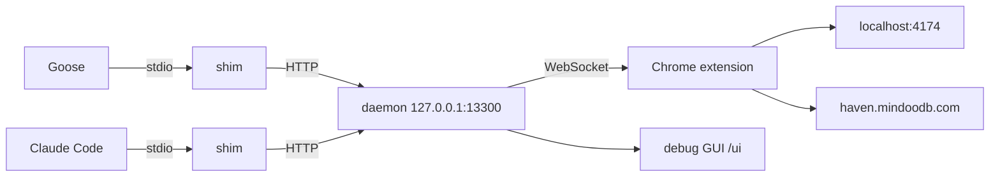

# Haven Agent Bridge

Connects the WebMCP tools of **one chosen browser tab** (Haven on `localhost:4174`, `haven.mindoodb.com`, the develop build, or any other site you allow) to MCP clients such as Goose, Claude Code, Claude Desktop or Cursor, and shows a debug GUI with the tools, every call with its response, statistics and an export.



What it does differently from [webmcp-bridge](https://github.com/nathan-gage/webmcp-bridge):

- **One tab per client, no duplicates.** A client sees the tools of exactly one tab, under their original names. Two Haven tabs no longer show every `haven_*` tool twice.
- **Bound to tab and origin.** You choose the tab in the extension popup or the GUI: the tab you used last (default), any tab of one origin, or one pinned tab. A call names the tab and the origin it expects; if the tab has navigated elsewhere, the call fails instead of running there.
- **Allowlist instead of `<all_urls>`.** Content scripts run only on allowed sites (default: `http://localhost:4174`, `https://haven.mindoodb.com`, `https://mindoodb-haven-develop.pages.dev`). Add more in the popup.
- **Calls go where the client looked.** A client's calls run in the tab, page document and tool definition of its last `tools/list`, even if you switch tabs in between. If that tab closed, reloaded or navigated, or the tool changed, the call is refused with `STATE_CHANGED` and the client is told to list again.
- **No blind retries.** If the connection breaks while a call is in flight, the client gets an error saying the call may or may not have run. The shim only re-sends what certainly never arrived (connection refused, unknown session after a daemon restart) or what is harmless to repeat (`tools/list`, `ping`).
- **Dynamic tools.** When the page re-registers its tools (Haven focusing another app, switching agent tools on or off) or you switch tabs, every affected client gets `notifications/tools/list_changed`.
- **Faithful to the page.** `AbortSignal` unregistration works; `readOnlyHint` → `readOnlyHint`, `consequentialHint` → `destructiveHint`, `untrustedContentHint` → `openWorldHint`; Haven's JSON errors (`{ error, message, requiredAction }`) also arrive as `structuredContent`.
- **Several clients at once.** One daemon holds the browser connection; every stdio client gets a small shim that starts the daemon when needed.
- **Debug GUI** with tabs, tools (schema, annotations, “try it”), call log with arguments and responses, protocol events (`tools/list`, `list_changed`, tab changes), statistics per tool and client (calls, errors, p50/p95, size) and JSON/NDJSON export, optionally redacted.

## Setup

```bash
npm install
npm run build
```

1. **Extension:** `chrome://extensions` → Developer mode → *Load unpacked* → the `extension/` folder. Disable the webmcp-bridge extension if it is installed, or both expose the same tools. Reload tabs that were open before.
2. **MCP client:** register the stdio command. Goose (`~/.config/goose/config.yaml`, replacing the `webmcp-bridge` entry):

   ```yaml
   extensions:
     haven:
       enabled: true
       type: stdio
       name: haven
       cmd: /Users/klehmann/.nvm/versions/node/v22.18.0/bin/node
       args:
         - /Users/klehmann/git/mindoodb-workspace/haven-agent-bridge/dist/cli.js
       timeout: 300
   ```

   Claude Code: `claude mcp add haven -- node /path/to/haven-agent-bridge/dist/cli.js`

   Clients that speak Streamable HTTP can also connect directly to `http://127.0.0.1:13300/mcp` with `Authorization: Bearer <token>` (token in `~/.haven-agent-bridge/token`).
3. **Haven:** Settings → General → offer tools to AI agents.

The extension badge shows the tool count of the selected tab (green), `–` when no allowed tab matches (yellow), nothing when the daemon is not running (grey).

## Commands

```bash
node dist/cli.js            # stdio MCP server (what the client runs)
node dist/cli.js daemon     # run the daemon in the foreground (--record, --port, --quiet)
node dist/cli.js ui         # open the debug GUI
node dist/cli.js status     # print the state as JSON
```

The daemon started by a client exits after 30 idle minutes. Settings (default tab, recording, fallback tools) live in `~/.haven-agent-bridge/settings.json`; the GUI and the popup change them.

## Debug GUI

Open it from the popup (*Debug GUI*) or with `node dist/cli.js ui`.

- **Calls:** every call with client, tab, status, duration and response size; click a row for arguments, response or error. Protocol events (tool lists sent, `list_changed`, tab changes, clients) are interleaved and can be hidden.
- **Tools:** the tools of any allowed tab with description, annotations and input schema, and a *Try it* form that runs a tool in that tab.
- **Tabs & clients:** the default tab for new clients and, per connected client, which tab it uses.
- **Statistics:** per tool and per client since the start or the last *Clear*.
- **Export:** JSON (log, statistics, tabs, clients) or NDJSON (log only); *Redact* replaces arguments, responses and errors with their length.

*Record payloads* is off by default: calls are then logged with timing but without arguments, responses or the page's error text, which can carry user data; only an error code such as `LOCKED` is kept (the bridge's own messages, like a refused call, are kept in full). Everything stays on this machine; with `logFile: true` in the settings the log is also appended to `~/.haven-agent-bridge/calls.ndjson`.

*Fallback tools* adds `bridge_tools_list` and `bridge_tool_call` for clients that ignore `list_changed`. Goose (since 2026-08) and Claude Code re-read their tools on `list_changed`.

## Security

The annotation mapping only gives the client hints; it enforces nothing. Approval and authorization stay in the page: Haven asks the user before a `consequentialHint` tool runs and checks its lock state itself.

- Daemon on `127.0.0.1` only; `Host` must be `127.0.0.1:<port>` or `localhost:<port>` (DNS rebinding).
- A 256-bit token guards `/mcp`, `/api` and the extension's WebSocket; files in `~/.haven-agent-bridge` are `0600`, the folder `0700`.
- Web pages cannot get the token: `/.well-known/haven-agent-bridge` and the API reject any `http(s)` Origin other than the GUI's own.
- The page relay only accepts messages that carry the nonce of its own content script, and only from the top frame of an allowed origin.

## Tests

```bash
npm test           # unit tests
npm run test:e2e   # Chromium with the extension, two test origins, HTTP and stdio clients, GUI
```

## How it works

| Part | File | Job |
| --- | --- | --- |
| Page hook | `extension/content-main.js` | Wraps `registerTool` / `unregisterTool` / `provideContext` / `clearContext` (and the `AbortSignal`) on `document.modelContext` and `navigator.modelContext`; polyfills both when the browser has no WebMCP; runs tools. |
| Relay | `extension/content-isolated.js` | Passes nonce-checked messages between the page and the extension; reports when the page goes away. |
| Service worker | `extension/background.js` | Allowlist and content-script registration, tab list with last-activation time, connection to the daemon, origin check before each call. |
| Daemon | `src/daemon.ts` | MCP sessions over Streamable HTTP, tab selection per client, `list_changed`, call routing, GUI API. |
| Shim | `src/shim.ts` | stdio ⇄ HTTP proxy; starts the daemon; re-initializes transparently after a daemon restart. |
| Log | `src/log.ts` | Ring buffer, statistics, redaction. |
| GUI | `ui/` | Plain HTML/JS, served by the daemon. |
